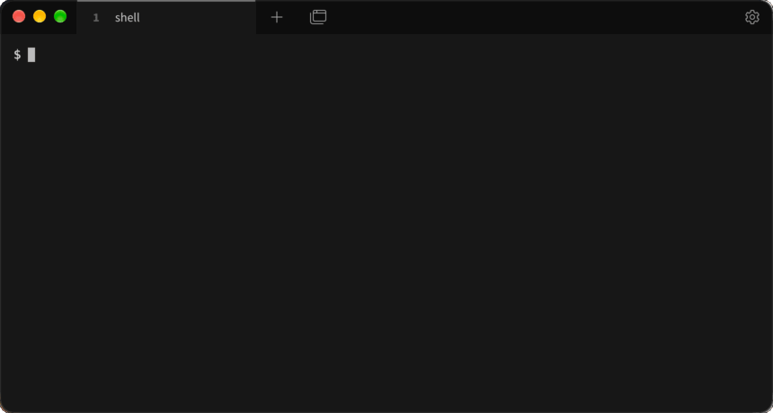

# tabby-bell-indicator

A [Tabby](https://github.com/Eugeny/tabby) plugin that shows a bell icon in a tab's header when a terminal in it rings the bell (BEL, `\x07`). You can then tell which tabs asked for your attention, for example a finished build or a prompt waiting for input. The icon is separate from Tabby's activity line, which any output triggers.

## What it does

- When a terminal rings the bell, its tab header shows an outline bell, right after the pin icon if the tab is pinned.
- A bell in a split pane shows on the tab that contains the split, at any nesting depth. The tab keeps the icon while any of its panes has an unseen bell.
- Only real bells count. A BEL that ends a control sequence, such as the one that sets the window title (`ESC ] 0;title BEL`), does not.
- Tabby's own bell behaviour (sound, visual bell, frame flash, activity line) is unchanged. The icon shows whatever Tabby's bell setting is, including "off".



## When the icon clears

| Where the bell rang | When the icon clears |
|---|---|
| A tab you are not looking at | When you open that tab. This clears every pane in it, including panes that don't have keyboard focus. |
| The tab you are looking at, with the Tabby window focused | 2 seconds after the last bell. Each new bell restarts the 2 seconds. |
| The open tab while the Tabby window is in the background | 2 seconds after you return to the window, so you can see which tab rang. |
| Another tab while the Tabby window is in the background | When you open that tab. |

If you switch away from a tab within the 2 seconds, the icon stays until you open that tab again. If the window loses focus during the 2 seconds, the icon clears 2 seconds after you return to the window.

A pane hidden behind a maximized pane keeps its icon until you open the tab again, or until you show and focus that pane: the icon then clears 2 seconds later.

There are no settings. To turn the feature off, disable the plugin in Tabby's settings (Settings, Plugins).

## Install

1. In Tabby, open Settings → Plugins.
2. Search for `bell-indicator`. Tabby lists the plugin under that name, without the `tabby-` prefix.
3. Install it, then restart Tabby.

Tabby finds plugins through npm's search. A new release can take a while to appear in the list, until npm's search index includes it.

## Tip: Claude Code

The icon only shows when a program actually rings the bell. Claude Code may notify you in another way, and then the icon doesn't show when Claude Code finishes or needs your input. To make it ring the bell:

1. In Claude Code, run `/config` and search for `notifications`.
2. Set **Local notifications** to **Terminal bell (\a)**.

This is stored in `~/.claude/settings.json` as `"preferredNotifChannel": "terminal_bell"`.

## Install from source

Use this to run a build of this repo instead, for example to try unreleased changes. If you installed the plugin from Settings → Plugins, uninstall it there first: both ways use the same folder, `plugins/node_modules/tabby-bell-indicator`.

Requires Node.js and npm.

```sh
npm ci
npm run build
```

Link the repo into Tabby's user plugins folder as `plugins/node_modules/tabby-bell-indicator`, then restart Tabby. Run the commands from the repo folder. The first command creates `plugins/node_modules` if Tabby hasn't created it yet, which happens when no plugin has been installed.

- macOS:
  ```sh
  mkdir -p ~/Library/Application\ Support/tabby/plugins/node_modules
  ln -s "$PWD" ~/Library/Application\ Support/tabby/plugins/node_modules/tabby-bell-indicator
  ```
- Linux:
  ```sh
  mkdir -p ~/.config/tabby/plugins/node_modules
  ln -s "$PWD" ~/.config/tabby/plugins/node_modules/tabby-bell-indicator
  ```
- Windows (PowerShell):
  ```powershell
  New-Item -ItemType Directory -Force -Path "$env:APPDATA\tabby\plugins\node_modules" | Out-Null
  New-Item -ItemType Junction -Path "$env:APPDATA\tabby\plugins\node_modules\tabby-bell-indicator" -Target $PWD
  ```

To check that it loaded, look in `log.txt` in Tabby's data folder (the parent of `plugins/`) for the line `tabby-bell-indicator: plugin loaded`.

Restart Tabby after every build.

## Development

```sh
npm run typecheck   # TypeScript
npm test            # unit tests (vitest)
npm run build       # webpack -> dist/index.js
npm run watch       # rebuild on change
```

Manual test results in a running Tabby are recorded in [`doc/TESTING.md`](doc/TESTING.md).

## Known limitation

Tabby has no extension point for tab-header content, so the plugin finds the tab headers in Tabby's page structure (`src/tabbyAdapter.ts`). A Tabby update that changes the tab header can stop the icon from showing. The plugin then logs a warning and keeps running, and the rest of Tabby is unaffected.

## License

MIT, see [LICENSE](LICENSE).
